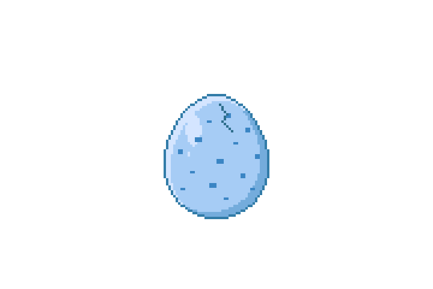

<!-- git-critters:start -->

  
   
  Made with <a href="https://github.com/aryamantepal/git-critters">git-critters</a>

<!-- git-critters:end -->

  # irfan firosh

  senior @ purdue university. building fun stuff, collecting side quests, and occasionally pretending my
  tabs are organized.

  [personal website](https://irfanfirosh.app/?ref=GitHub)

  ## currently

  building competitive tools, small experiments, and whatever seems fun enough to ship.

  ## elsewhere

  [twitter](https://x.com/IFirosh) · [linkedin](https://www.linkedin.com/in/irfan-firosh/) · [mail](mailto:irfan.firosh@gmail.com)

  
